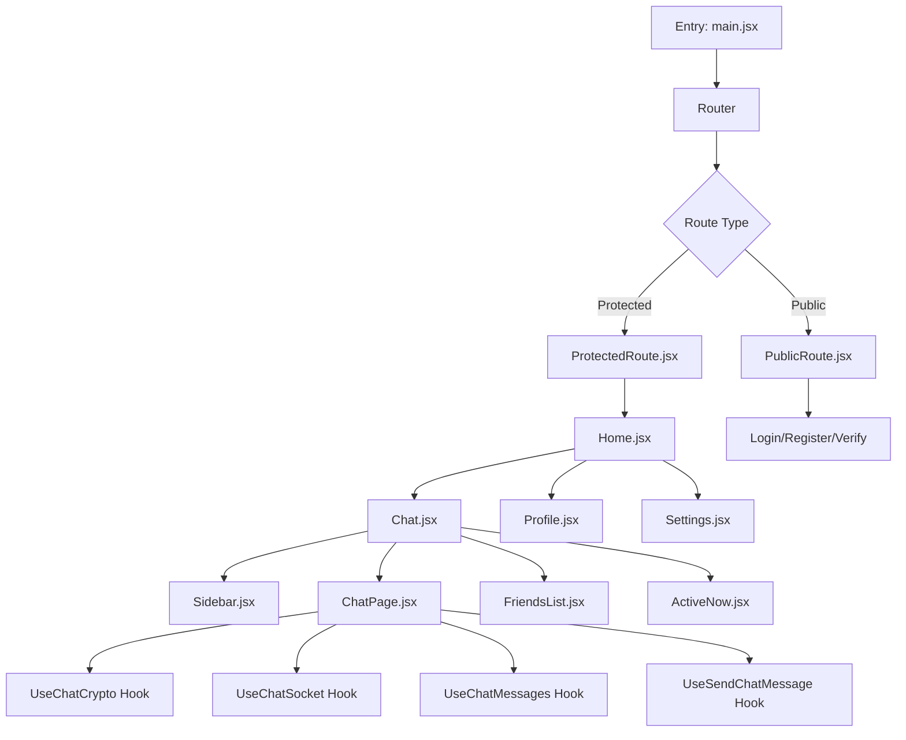
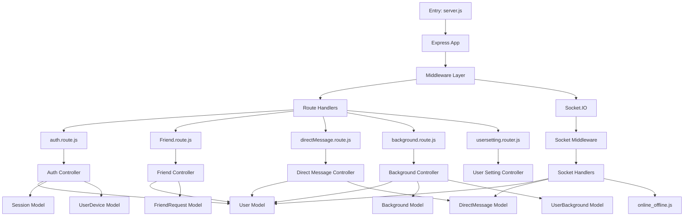
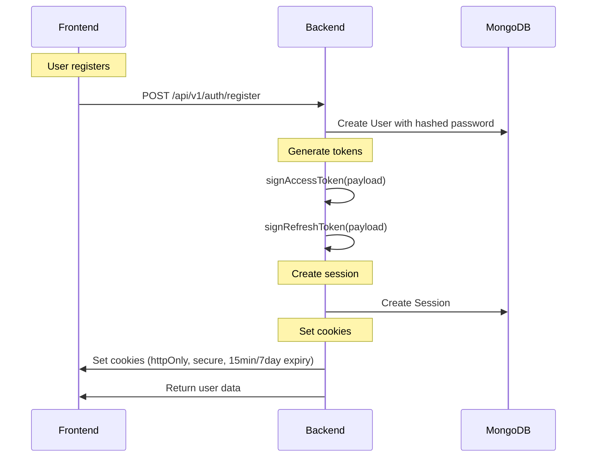
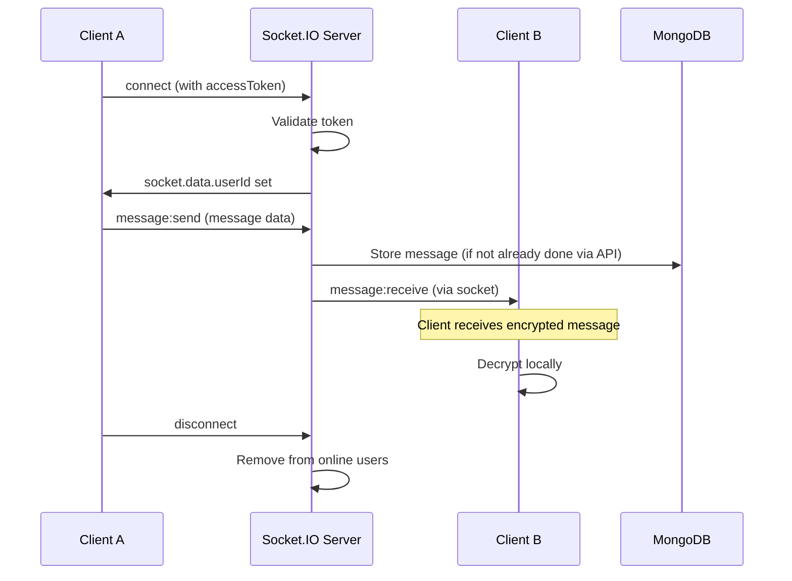

# WOLVO Architecture Documentation

## System Overview

Wolvo is a Discord-like real-time communication application with End-to-End Encryption (E2EE) support. It follows a client-server architecture with WebSocket real-time messaging.

---

## High-Level Architecture

```
┌─────────────────────────────────────────────────────────────────────────────┐
│                              CLIENT-SIDE                                     │
├─────────────────────────────────────────────────────────────────────────────┤
│  ┌──────────────┐  ┌─────────────┐  ┌─────────────────┐  ┌──────────────┐ │
│  │ React 19     │  │ Vite        │  │ TailwindCSS     │  │ Socket.IO    │ │
│  │ Router       │  │ Build       │  │ Components      │  │ Client       │ │
│  │ Redux        │  │ HMR         │  │ Framer Motion   │  │              │ │
│  │ TanStack     │  │             │  │ Lucide Icons    │  │              │ │
│  │ Query        │  │             │  │                 │  │              │ │
│  └──────────────┘  └─────────────┘  └─────────────────┘  └──────────────┘ │
│           │                │                │                │           │
│           └────────────────┴────────────────┴────────────────┴───────────┘ │
│                              API COMMUNICATION                             │
│                       (HTTPS + WebSockets)                                 │
├─────────────────────────────────────────────────────────────────────────────┤
│                              SERVER-SIDE                                     │
├─────────────────────────────────────────────────────────────────────────────┤
│  ┌──────────────┐  ┌─────────────┐  ┌─────────────────┐  ┌──────────────┐ │
│  │ Node.js 20+  │  │ Express 5   │  │ Socket.IO 4       │  │ Multer       │ │
│  │ ES Modules   │  │ Routes      │  │ Events            │  │ ImageKit     │ │
│  │ Environment  │  │ Controllers │  │ Middleware      │  │              │ │
│  │ CORS         │  │ Middleware  │  │                 │  │              │ │
│  └──────────────┘  └─────────────┘  └─────────────────┘  └──────────────┘ │
│           │                │                │                │           │
│           └────────────────┴────────────────┴────────────────┴───────────┘ │
│                              DATABASE                                        │
│                    ┌─────────────────────────────┐                           │
│                    │     MongoDB (Atlas)         │                           │
│                    ├─────────────────────────────┤                           │
│                    │ User Collection           │                           │
│                    │ Session Collection          │                           │
│                    │ FriendRequest Collection    │                           │
│                    │ DirectMessage Collection    │                           │
│                    │ Background Collection       │                           │
│                    │ UserBackground Collection   │                           │
│                    │ UserDevice Collection       │                           │
│                    └─────────────────────────────┘                           │
└─────────────────────────────────────────────────────────────────────────────┘
```

---

## Component Architecture

### Frontend Layers



### Backend Layers



---

## Database Schema

### User Schema (`server/src/model/auth.model.js`)

```
User
├── _id: ObjectId (Primary Key)
├── username: String (unique, required, 50 chars max)
├── name: String (required, 50 chars max)
├── email: String (unique, required, indexed)
├── password: String (required, excluded from queries)
├── profileimg: String (URL)
├── publicKey: String (E2EE public key)
├── isEmailVerified: Boolean (default: false)
├── friends: [ObjectId] (ref: User)
│
├── Email Verification Fields
│   ├── emailVerificationOtpHash: String
│   ├── emailVerificationOtpExpires: Date
│   ├── emailVerificationAttempts: Number
│   ├── emailVerificationLastSentAt: Date
│   ├── emailVerificationOtpGeneratedCount: Number
│   ├── emailVerificationOtpBlockedUntil: Date
│   └── emailVerificationLockedUntil: Date
│
└── timestamps: createdAt, updatedAt
```

### Session Schema (`server/src/model/session.model.js`)

```
Session
├── _id: ObjectId
├── refreshToken: String (hashed)
├── userId: ObjectId (ref: User, required)
├── deviceId: String (required)
├── verify: Boolean (default: false)
├── expiryDate: Date (required)
├── browser: String (default: "Unknown")
├── os: String (default: "Unknown")
├── ipAddress: String
├── userAgent: String
├── lastActiveAt: Date
│
└── timestamps: createdAt, updatedAt

Index: { userId: 1, deviceId: 1 } unique true
```

### FriendRequest Schema (`server/src/model/friendRequest.model.js`)

```
FriendRequest
├── _id: ObjectId
├── sender: ObjectId (ref: User, required)
├── receiver: ObjectId (ref: User, required)
└── status: String (enum: pending|accepted|rejected, default: pending)

│
└── timestamps: createdAt, updatedAt
```

### DirectMessage Schema (`server/src/model/chat/directMessage.model.js`)

```
DirectMessage
├── _id: ObjectId
├── sender: ObjectId (ref: User)
├── receiver: ObjectId (ref: User)
├── senderDeviceId: String
├── deviceMessagesreceiver: [{
│     senderDeviceId: String
│     receiverDeviceId: String
│     encryptedText: String
│     iv: String
│ }]
├── deviceMessagessender: [{
│     senderDeviceId: String
│     encryptedText: String
│     iv: String
│ }]
├── image: String (default: "")
├── seen: Boolean (default: false)
├── deleted: Boolean (default: false)
├── replyTo: ObjectId (ref: DirectMessage)
├── edited: Boolean (default: false)
└── editedAt: Date

│
└── timestamps: createdAt, updatedAt
```

### Background Schema (`server/src/model/background.model.js`)

```
Background
├── _id: ObjectId
├── name: String (required)
├── imageUrl: String (required)
│
└── timestamps: createdAt, updatedAt
```

### UserBackground Schema (`server/src/model/userBackground.model.js`)

```
UserBackground
├── _id: ObjectId
├── user: ObjectId (ref: User, required, unique)
├── background: ObjectId (ref: Background, required)
│
└── timestamps: createdAt, updatedAt
```

### UserDevice Schema (`server/src/model/userDevice.model.js`)

```
UserDevice
├── _id: ObjectId
├── userId: ObjectId (ref: User, required)
├── deviceId: String (required)
├── publicKey: String (required)
├── browser: String (default: "Unknown")
├── os: String (default: "Unknown")
├── lastActiveAt: Date
│
└── timestamps: createdAt, updatedAt

Index: { userId: 1, deviceId: 1 } unique true
```

---

## API Endpoints

### Authentication Endpoints

| Method | Endpoint | Auth | Description |
|--------|----------|------|-------------|
| POST | `/api/v1/auth/register` | No | Register new user |
| POST | `/api/v1/auth/login` | No | User login |
| POST | `/api/v1/auth/logout` | Yes | User logout |
| GET | `/api/v1/auth/refresh` | No* | Refresh access token |
| GET | `/api/v1/auth/accesstoken` | No* | Verify access token |
| GET | `/api/v1/auth/checkUsername/:username` | No | Check username availability |
| POST | `/api/v1/auth/send-verification` | No | Send email OTP |
| POST | `/api/v1/auth/verify-email` | No | Verify email with OTP |
| POST | `/api/v1/auth/resend-verification` | No | Resend email OTP |
| POST | `/api/v1/auth/public-key` | Yes | Save user public key |
| GET | `/api/v1/auth/public-key/:userId` | Yes | Get user public keys |
| GET | `/api/v1/auth/login-devices` | Yes | Get login devices |

### Friend Endpoints

| Method | Endpoint | Auth | Description |
|--------|----------|------|-------------|
| POST | `/api/v1/friends/request` | Yes | Send friend request |
| PATCH | `/api/v1/friends/accept/:requestId` | Yes | Accept friend request |
| PATCH | `/api/v1/friends/reject/:requestId` | Yes | Reject friend request |
| GET | `/api/v1/friends/requests` | Yes | Get incoming requests |
| GET | `/api/v1/friends/sent` | Yes | Get sent requests |
| GET | `/api/v1/friends` | Yes | Get friends list |
| GET | `/api/v1/friends/pending` | Yes | Get pending requests |
| DELETE | `/api/v1/friends/:friendId` | Yes | Remove friend |

### Direct Message Endpoints

| Method | Endpoint | Auth | Description |
|--------|----------|------|-------------|
| POST | `/api/v1/chat/directMessage/send-directMessage` | Yes | Send message |
| GET | `/api/v1/chat/directMessage/direct-message/:userId` | Yes | Get messages |
| GET | `/api/v1/chat/directMessage/direct-messagechatUsers` | Yes | Get talked users |

### Background Endpoints

| Method | Endpoint | Auth | Description |
|--------|----------|------|-------------|
| GET | `/api/v1/background/all` | No | Get all backgrounds |
| GET | `/api/v1/background/user-background` | Yes | Get user's background |
| PUT | `/api/v1/background/user-background` | Yes | Set user's background |
| PUT | `/api/v1/background/set-profileimg` | Yes | Set profile image |

### User Settings Endpoints

| Method | Endpoint | Auth | Description |
|--------|----------|------|-------------|
| PUT | `/api/v1/usersetting/update-name` | Yes | Update username |

---

## Authentication Flow



---

## Socket.IO Event Flow



---

## Environment Configuration

### Server Environment Variables (.env)

```bash
# Server
PORT=3000
MONGO_URI=mongodb+srv://...
NODE_ENV=development|production

# JWT
JWT_SECRET=your-jwt-secret
JWT_EXPIRES_IN=15m
REFRESH_SECRET=your-refresh-secret
REFRESH_EXPIRES_IN=7d

# ImageKit
IMAGEKIT_PUBLIC_KEY=your-public-key
IMAGEKIT_PRIVATE_KEY=your-private-key
IMAGEKIT_URL_ENDPOINT=https://ik.imagekit.io/...

# Email (SMTP)
EMAIL_USER=you@gmail.com
EMAIL_APP_PASSWORD=your-app-password

# Frontend Origin (for CORS)
FRONTEND_ORIGIN=http://localhost:5173
```

### Frontend Environment Variables (.env)

```bash
VITE_API_URL=http://localhost:3000/api/v1/
VITE_BACKEND_URL=http://localhost:3000
```

---

## Current Deployment Status

### What's Working
- User registration and login
- Email verification with OTP
- E2EE message encryption
- Friend system
- Background customization
- Socket.IO real-time messaging

### What Needs Testing
- Token refresh flow
- Multi-device message synchronization
- Logout across devices
- Rate limiting effectiveness

### What's Not Working
- Password change functionality (endpoint doesn't exist)
- Forgotten password flow (endpoint doesn't exist)

---

## Tech Stack Summary

| Layer | Technology | Version |
|-------|------------|---------|
| **Runtime** | Node.js | 20+ |
| **Framework** | Express | 5.2.1 |
| **Database** | MongoDB | 9.7.3 (Mongoose) |
| **WebSocket** | Socket.IO | 4.8.3 |
| **Frontend** | React | 19.2.7 |
| **Build** | Vite | 8.1.1 |
| **State** | Redux Toolkit | 2.12.0 |
| **HTTP** | Axios | 1.18.1 |
| **Crypto** | Web Crypto API | Browser Native |
| **UI** | TailwindCSS | 4.3.2 |
| **Icons** | Lucide React | 1.25.0 |
| **Animations** | Framer Motion | 12.43.0 |
| **Forms** | React Hook Form | 7.81.0 |
| **Routing** | React Router DOM | 7.18.1 |
| **Validation** | React Hook Form | 7.81.0 |
| **HTTP Client** | Socket.IO Client | 4.8.3 |

---

## Third-Party Services

| Service | Purpose | Integration |
|---------|---------|-------------|
| ImageKit | Image storage & CDN | Upload service for profile images |
| Gmail SMTP | Email sending | Email verification OTP |
| MongoDB Atlas | Database hosting | Persistent data storage |