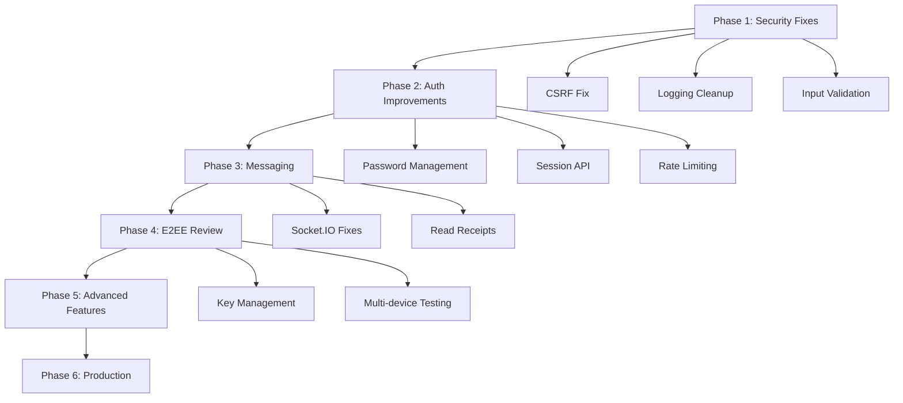

# WOLVO Development Roadmap

## Overview

This roadmap prioritizes development tasks based on security issues, incomplete features, and architectural improvements needed for production readiness.

---

## Phase 1 — Core Application Stability

**Duration:** 1-2 weeks

### Objectives
- Fix critical bugs and security gaps
- Complete unfinished functionality
- Improve error handling

### Tasks

#### Critical Security Fixes
- [ ] **Activate CSRF protection** (server/src/app.js:32-42)
  - Uncomment and apply `verifyCsrfOrigin` middleware
  - Test all state-changing endpoints

- [ ] **Remove sensitive debug logging**
  - Remove deviceId logging in auth.controller.js
  - Remove email/user logging in auth.controller.js
  - Remove key prefix logging in image.service.js

#### Bug Fixes
- [ ] **Fix image.service.js API key exposure**
  - Use config values instead of hardcoded key
  - Location: server/src/config/imgkit/image.service.js:5

- [ ] **Fix directMessage validation**
  - The API has validation but should return appropriate HTTP status codes
  - Location: server/src/controller/chat/directMessage.controller.js

- [ ] **Verify getDirectMessages implementation**
  - Currently returns messages but needs full testing
  - Location: directMessage.controller.js:355-450

#### Code Quality
- [ ] Add input validation middleware
  - Integrate express-validator or Joi
  - Apply to all incoming requests

#### Testing
- [ ] Write unit tests for controllers
  - auth.controller.js functions
  - directMessage.controller.js functions
  - Friend.controller.js functions

---

## Phase 2 — Authentication & Security

**Duration:** 2-3 weeks

### Objectives
- Complete password management
- Strengthen authentication security
- Implement proper session handling

### Tasks

#### Password Management
- [ ] **Implement "Change Password" endpoint**
  - Endpoint: `PUT /api/v1/usersetting/change-password`
  - Requires: currentPassword, newPassword
  - Validate password strength
  - Hash and update password

- [ ] **Implement "Forgot Password" flow**
  - Endpoint: `POST /api/v1/auth/forgot-password`
  - Generate secure reset token
  - Send email with reset link
  - Token expiry (1 hour recommended)

- [ ] **Implement "Reset Password" endpoint**
  - Endpoint: `POST /api/v1/auth/reset-password`
  - Validate token from URL
  - Allow password change
  - Invalidate token after use

#### Session Management
- [ ] **Add "Get All Sessions" endpoint**
  - Allow users to see all active sessions
  - Show device info, last active time
  - Location: Use existing Session model

- [ ] **Add "Revoke Session" endpoint**
  - Allow users to revoke specific device sessions
  - Delete from Session collection

- [ ] **Add "Logout All Devices" endpoint**
  - Delete all sessions for user
  - Clear all auth cookies

#### Token Security
- [ ] **Implement token revocation list**
  - Store revoked token IDs
  - Check during authentication
  - Allow immediate logout across devices

#### Rate Limiting
- [ ] **Apply rate limiters to all auth routes**
  - Currently only refresh and access token have limiters
  - Apply to login, register, password endpoints

---

## Phase 3 — Real-Time Communication

**Duration:** 2-3 weeks

### Objectives
- Improve messaging reliability
- Enhance Socket.IO handling
- Fix online/offline presence

### Tasks

#### Socket.IO Improvements
- [ ] **Fix online/offline presence tracking**
  - Current implementation only notifies friends
  - Consider adding broader presence features

- [ ] **Add message ACK mechanism**
  - Confirm message delivery to server
  - Re-attempt on failure

- [ ] **Implement typing indicators UI**
  - Currently server-side exists
  - Need frontend integration

#### Chat Features
- [ ] **Implement message read receipts**
  - Track when messages are viewed
  - Update `seen` field in directMessage model

- [ ] **Implement message reactions**
  - Add reactions field to message model
  - WebSocket event for reaction updates

- [ ] **Implement message deletion**
  - Soft delete (set `deleted: true`)
  - Hard delete option for administrators

- [ ] **Implement message editing**
  - Currently tracked in model
  - Add endpoint to edit messages

#### Media Support
- [ ] **Implement voice/messages**
  - Voice note recording and playback
  - Voice call infrastructure (future)

---

## Phase 4 — E2EE (End-to-End Encryption)

**Duration:** 3-4 weeks

### Objectives
- Review encryption architecture
- Fix key-management issues
- Verify multi-device encryption

### Tasks

#### Key Management
- [ ] **Document key backup strategy**
  - Warn users about device-specific data loss
  - Consider implementing encrypted key backup

- [ ] **Implement key rotation**
  - Allow users to rotate encryption keys
  - Re-encrypt all messages with new key

- [ ] **Add key export/import**
  - Allow users to export keys
  - Secure import mechanism

#### Multi-Device Support
- [ ] **Test multi-device scenarios**
  - Messages sent from one device
  - Read on another device
  - Cross-device synchronization

- [ ] **Handle device key changes**
  - Detect new devices
  - Request public key from new device

#### Security Review
- [ ] **Penetration test encryption implementation**
  - Verify no plaintext messages stored
  - Check for implementation flaws
  - Validate key exchange security

---

## Phase 5 — Advanced Features

**Duration:** 4-6 weeks

### Objectives
- Add Discord-like functionality
- Improve user experience

### Tasks

#### Profile Features
- [ ] **Implement profile customization settings**
  - Bio/description field
  - Avatar customization
  - Theme preferences

- [ ] **Implement user status**
  - Online, Away, Do Not Disturb, Offline
  - Custom status message

- [ ] **Implement server creation/joining**
  - Server model and routes
  - Invite system
  - Role-based permissions

#### Social Features
- [ ] **Implement blocking users**
  - Add blockList to User model
  - Filter messages from blocked users

- [ ] **Implement message threading**
  - Reply functionality (partial - replyTo field exists)
  - Thread view

- [ ] **Implement pinned messages**
  - Pin messages in channels
  - Unpin functionality

#### Notifications
- [ ] **Implement push notifications**
  - Web Push API integration
  - Email notifications for important events

- [ ] **Implement in-app notification center**
  - Store notifications
  - Mark as read functionality

---

## Phase 6 — Scalability & Production

**Duration:** 3-4 weeks

### Objectives
- Performance optimization
- Production deployment readiness

### Tasks

#### Backend Scaling
- [ ] **Add Redis for session storage**
  - Replace MongoDB session storage with Redis
  - Faster session lookups

- [ ] **Implement message caching**
  - Cache recent messages per conversation
  - Reduce database queries

- [ ] **Add rate limiting per user**
  - More granular rate limiting
  - Prevent single user from overwhelming system

- [ ] **Implement database indexing**
  - Compound indexes for common queries
  - Analyze query performance

#### Frontend Optimization
- [ ] **Implement code splitting**
  - Lazy load routes
  - Reduce initial bundle size

- [ ] **Add message pagination**
  - Infinite scroll for messages
  - Load older messages on demand

- [ ] **Implement offline message support**
  - Queue messages when offline
  - Send when connection restored

#### Infrastructure
- [ ] **Add monitoring and logging**
  - Application performance monitoring
  - Error tracking (Sentry-like)
  - Structured logging

- [ ] **Implement health check endpoints**
  - Database health
  - Redis health
  - External services (EmailKit)

- [ ] **Add CI/CD pipeline**
  - Automated testing
  - Linting
  - Security scanning

- [ ] **Configure production environment**
  - Reverse proxy (Nginx)
  - HTTPS with Let's Encrypt
  - Environment-specific config

---

## Dependencies Graph

---

## Priority Matrix

| Priority | Tasks |
|----------|-------|
| **P0 - Critical** | CSRF protection, sensitive logging removal |
| **P1 - High** | Password management, session API, file upload validation |
| **P2 - Medium** | Token revocation, message read receipts, notifications |
| **P3 - Low** | Code splitting, advanced features, deployment |

---

## Estimated Effort

| Phase | Estimated Hours | Developer Weeks |
|-------|-----------------|-----------------|
| Phase 1 | 40-60 hours | 1-2 weeks |
| Phase 2 | 80-120 hours | 2-3 weeks |
| Phase 3 | 60-80 hours | 2-2 weeks |
| Phase 4 | 80-100 hours | 3-4 weeks |
| Phase 5 | 100-150 hours | 4-6 weeks |
| Phase 6 | 60-80 hours | 3-4 weeks |

**Total Estimated Effort:** 420-620 hours (~3-4 months for a single developer)