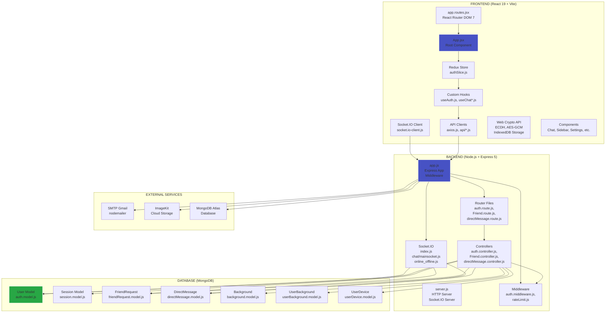
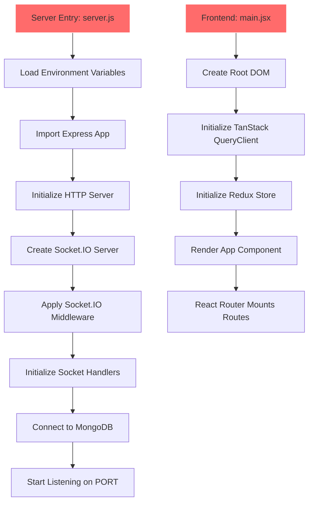
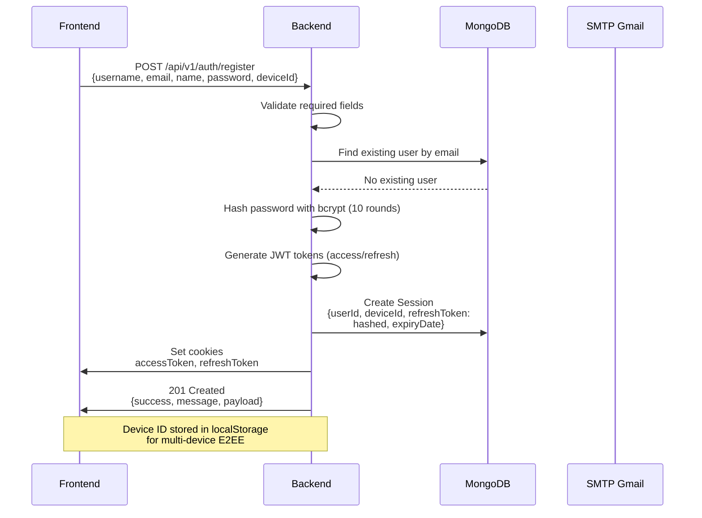
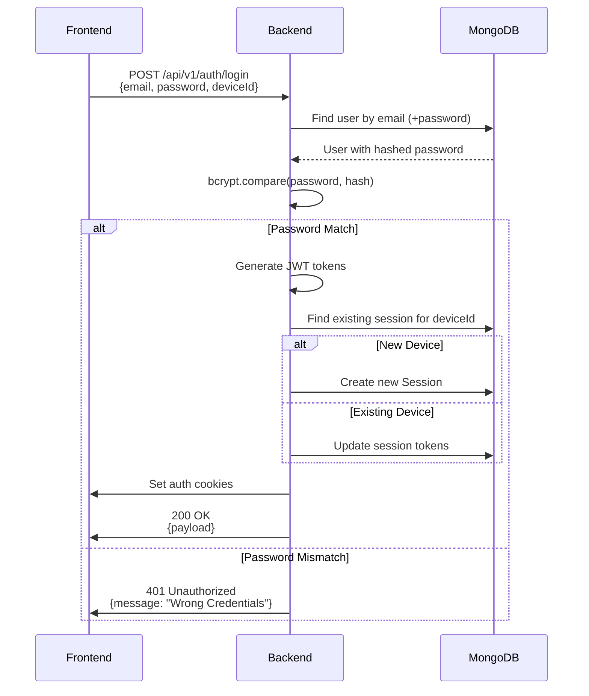
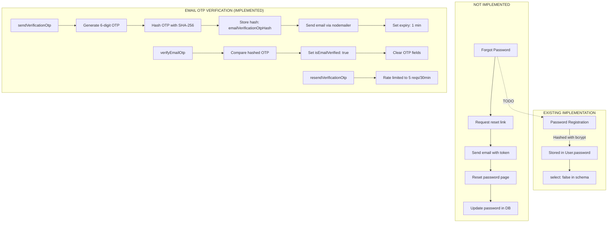
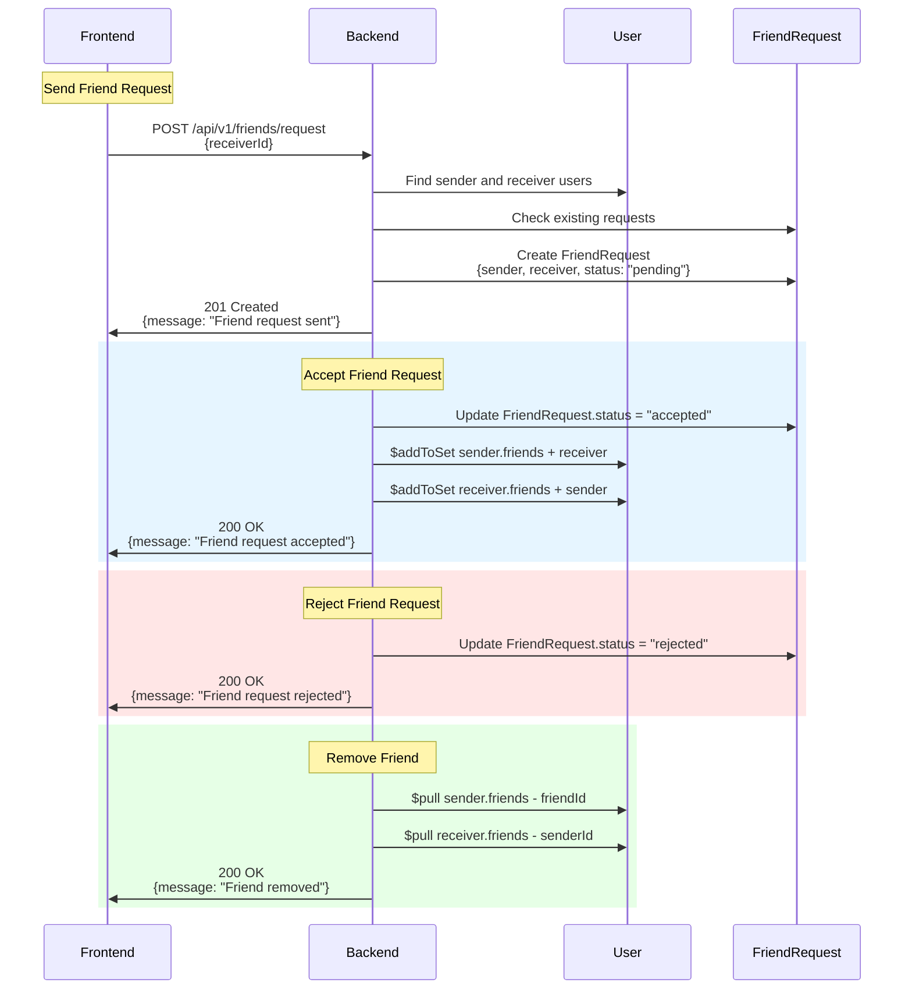
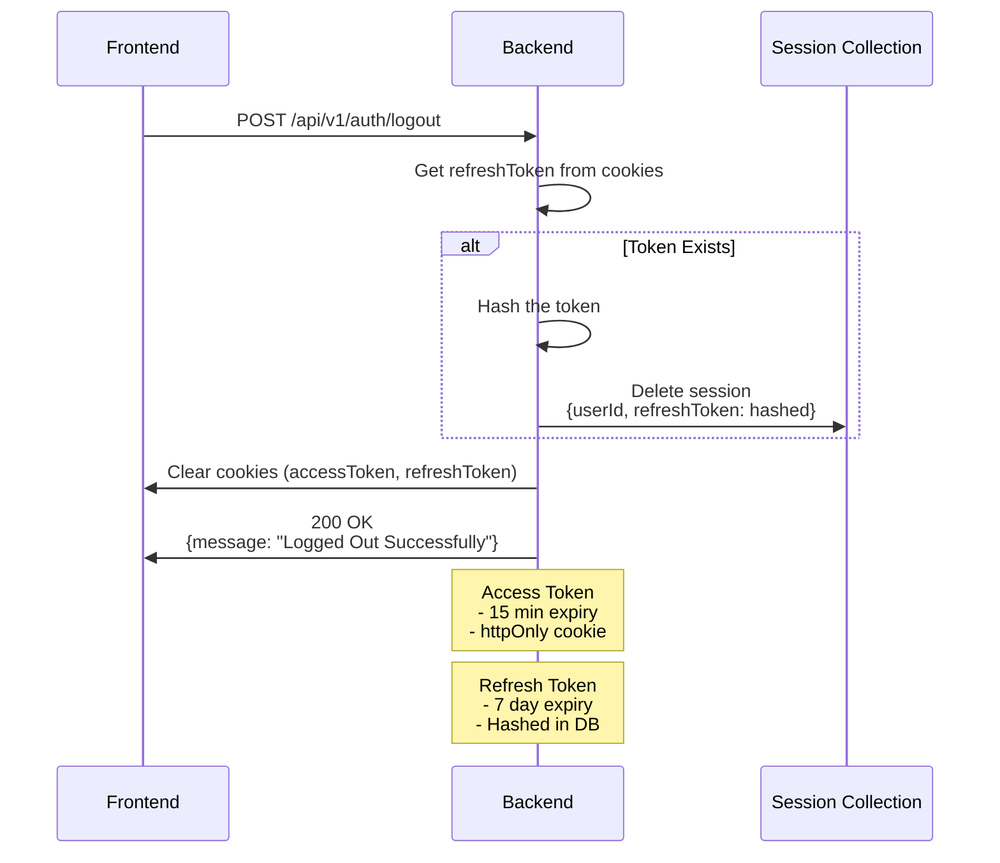
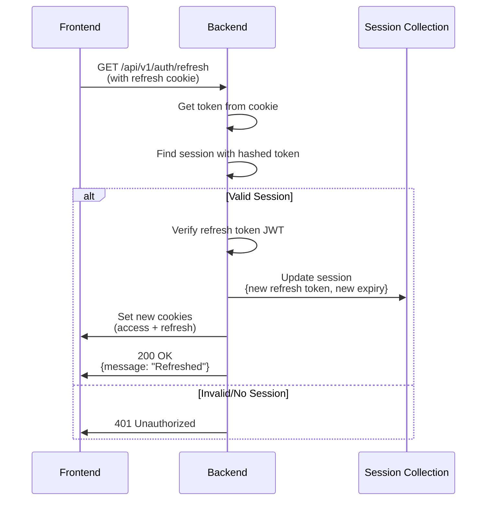
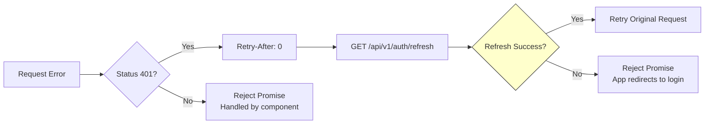

# WOLVO PROJECT FLOWCHART & ARCHITECTURE DOCUMENTATION

## A. Complete Application Architecture



## B. Application Startup Flow



## C. User Registration Flow



## D. Login & Authentication Flow



## E. Password Management Flow



### Password/Forgot Password Status

| Feature | Status | Implementation |
|---------|--------|----------------|
| Password hashing on registration | IMPLEMENTED | bcrypt with 10 rounds |
| Password verification on login | IMPLEMENTED | bcrypt.compare() |
| Password update (current password) | NOT IMPLEMENTED | No endpoint exists |
| Forgot password flow | NOT IMPLEMENTED | No endpoint exists |
| Reset password with token | NOT IMPLEMENTED | No endpoint exists |

## F. Real-Time Messaging Flow

```mermaid
sequenceDiagram
    participant Sender as Sender Device
    participant Server as Backend
    participant Receiver as Receiver Device
    participant DB as MongoDB

    Note over Sender: Message is encrypted<br/>locally with E2EE keys
    
    Sender->>Server: POST /api/v1/chat/directMessage/send-directMessage<br/>{
        receiver, senderDeviceId,<br/>deviceMessagesreceiver,<br/>deviceMessagessender, image
    }
    Server->>DB: Create directMessage document
    DB-->>Server: Saved message
    Server->>Server: Emit via Socket.IO<br/>mainchat(io, receiver, message)
    Server->>Receiver: io.to(socketId).emit(message:receive)
    Receiver->>Receiver: Decryption happens<br/>locally with shared keys
    
    Note over Sender,Receiver: E2EE Key Details:<br/>- ECDH P-256 key pairs per device<br/>- AES-GCM 256-bit encryption<br/>- Keys stored in IndexedDB
```

### Message Model (directMessage.model.js)

```
┌─────────────────────────────────────────────────────────────────────────┐
│ directMessage                                                           │
├─────────────────────────────────────────────────────────────────────────┤
│ sender: ObjectId (ref: User)           ← Required                      │
│ receiver: ObjectId (ref: User)       ← Required                      │
│ senderDeviceId: String                 ← Required                      │
│ deviceMessagesreceiver: [{             ← Encrypted for each receiver   │
│   senderDeviceId: String,             │ device                         │
│   receiverDeviceId: String,           │                               │
│   encryptedText: String,              │                               │
│   iv: String                          │                               │
│ }]>                                   ← Required                      │
│ deviceMessagessender: [{               ← Encrypted for each sender     │
│   senderDeviceId: String,             │ device (self-read)           │
│   encryptedText: String,              │                               │
│   iv: String                          │                               │
│ }]>                                   ← Required                      │
│ image: String                        ← Optional attachment             │
│ seen: Boolean (default: false)                                        │
│ deleted: Boolean (default: false)                                     │
│ replyTo: ObjectId (ref: directMessage)                                  │
│ edited: Boolean (default: false)                                      │
│ editedAt: Date (default: null)                                        │
└─────────────────────────────────────────────────────────────────────────┘
```

## G. Friend System Flow



## H. User Settings Flow

```mermaid
graph LR
    A[Update Name] -->|PUT /api/v1/usersetting/update-name| B[usersetting.controller.js]
    B --> C[User.findByIdAndUpdate]
    C --> D[DB]
    D --> E[200 OK<br/>{message: "Name updated"}]
```

## I. Logout & Session Management Flow



### Token Refresh Flow



## J. Error Handling Flow

```mermaid
graph TD
    A[API Error] --> B{Error Type}
    B -->|Validation| C[400 Bad Request<br/>{success: false, message}]
    B -->|Not Found| D[404 Not Found<br/>{success: false, message}]
    B -->|Unauthorized| E[401 Unauthorized<br/>{success: false, message}]
    B -->|Forbiddden| F[403 Forbidden<br/>{success: false, message}]
    B -->|Conflict| G[409 Conflict<br/>(Duplicate email/username)]
    B -->|Rate Limit| H[429 Too Many<br/>Retry-After header]
    B -->|Server Error| I[500 Internal Server Error<br/>{success: false, message}]
    
    J[Frontend Error] --> K{Error Source}
    K -->|API Response| L[Show error message<br/>from response.data.message]
    K -->|Network| M[Show generic error<br/>"No response from server"]
    K -->|Axios Interceptor| N[Auto-refresh on 401<br/>then retry request]
```

### Frontend Error Handling (axios.js)

